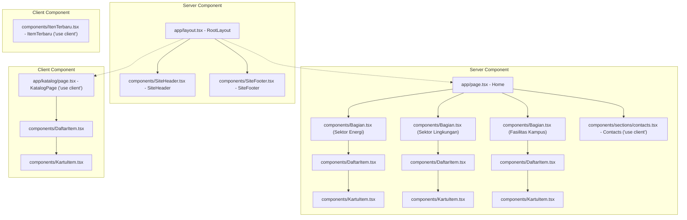
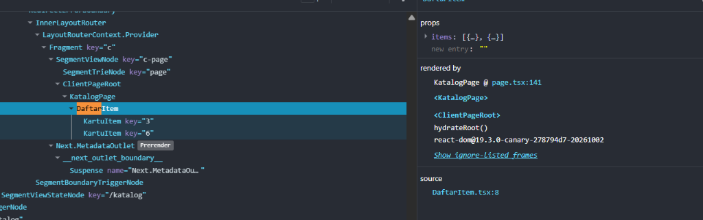
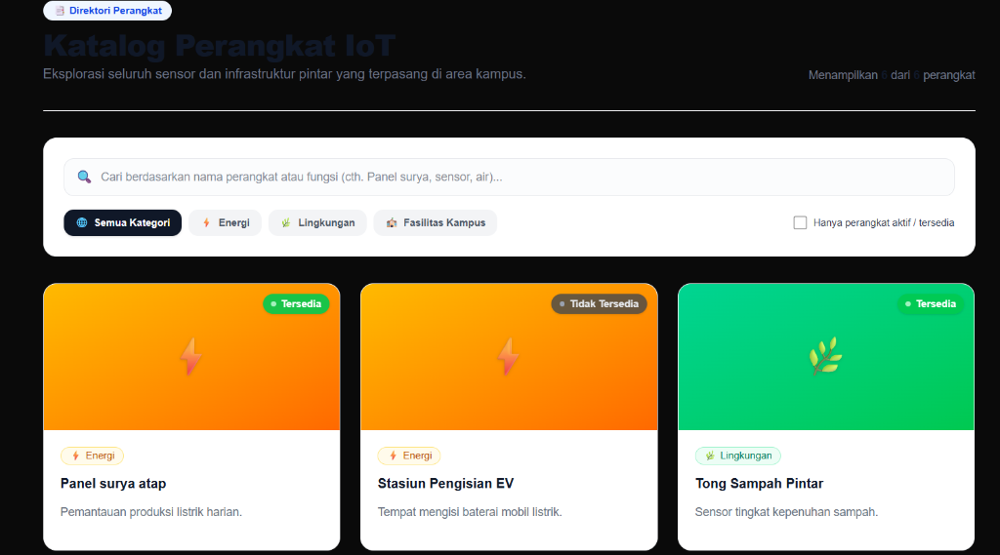
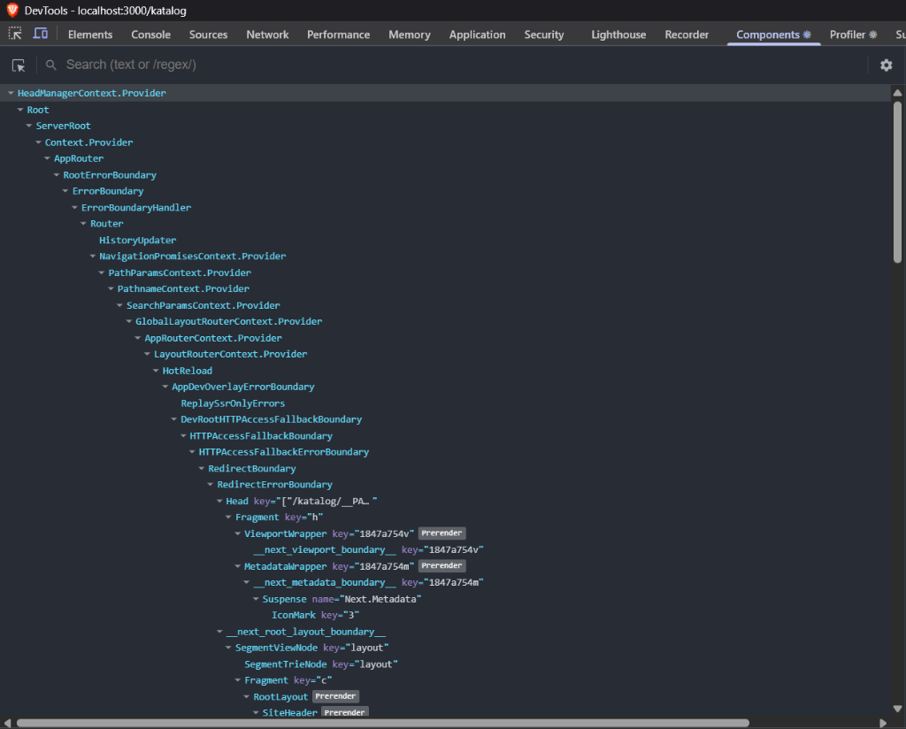
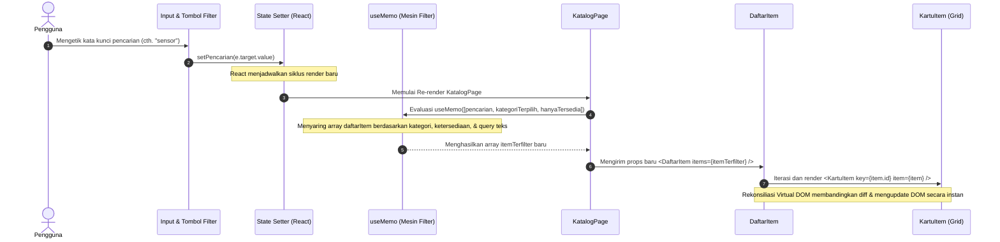

# Dokumentasi Teknis Modul 3 — TypeScript dan Komponen React

**Nama / NIM:** Naufal Fakhrianto / 105224026  
**Repositori:** [https://github.com/Naufal-strong/105224026_PraktikumPemWeb_Modul3.git](https://github.com/Naufal-strong/105224026_PraktikumPemWeb_Modul3.git)  
**Tanggal:** 13 Oktober 2026  
**Framework & Teknologi:** Next.js 16 (App Router) + React 19 + TypeScript 5 + Tailwind CSS v4  

---

## 1. Tipe Data Produk (Product Data Types)

Definisi model data dan struktur tipe untuk perangkat IoT pada proyek ini dideklarasikan secara terpusat di dalam berkas [`lib/types.ts`](file:///c:/Users/USER%20HP/Downloads/Tugas/codeblock/Kuliah/Pemrograman%20Web%20dan%20Aplikasi/Praktikum%20week%203/week3/lib/types.ts) (serta disinkronkan pada [`lib/tipe.ts`](file:///c:/Users/USER%20HP/Downloads/Tugas/codeblock/Kuliah/Pemrograman%20Web%20dan%20Aplikasi/Praktikum%20week%203/week3/lib/tipe.ts)).

### Kode Sumber (`lib/types.ts`)

```typescript
export type Kategori = "energi" | "lingkungan" | "kampus";

export interface Item {
    id: number;
    judul: string;
    kategori: Kategori;
    deskripsi: string;
    tersedia: boolean;
    gambar?: string;
}
```

### Penjelasan Pemilihan Union Types dan Optional Properties

#### 1. Pemilihan Union Types (`Kategori = "energi" | "lingkungan" | "kampus"`)
* **Keamanan Tipe Ketat (*Strict Type Safety*) & Batasan Domain**:  
  Alih-alih menggunakan tipe data `string` bebas yang rentan terhadap kesalahan ketik (*typo* seperti `"energy"` vs `"energi"`), *string literal union* membatasi nilai yang valid hanya pada tiga domain kategori perangkat IoT yang dikenali sistem. Kesalahan input akan langsung terdeteksi pada saat kompilasi (*compile-time*).
* **Pengecekan Tuntas (*Exhaustiveness Checking*)**:  
  Saat memetakan konfigurasi tampilan visual (seperti warna gradien, lencana badge, dan ikon emoji) menggunakan tipe utilitas `Record<Kategori, ...>` di [`KartuItem.tsx`](file:///c:/Users/USER%20HP/Downloads/Tugas/codeblock/Kuliah/Pemrograman%20Web%20dan%20Aplikasi/Praktikum%20week%203/week3/components/KartuItem.tsx) dan [`Bagian.tsx`](file:///c:/Users/USER%20HP/Downloads/Tugas/codeblock/Kuliah/Pemrograman%20Web%20dan%20Aplikasi/Praktikum%20week%203/week3/components/Bagian.tsx), TypeScript mewajibkan penanganan seluruh varian kategori secara lengkap tanpa ada yang tertinggal.
* **Pengalaman Pengembang (*Developer Experience*)**:  
  Menyediakan fitur *IntelliSense* dan *autocomplete* otomatis di lingkungan IDE saat melakukan operasi filtering maupun penambahan data perangkat baru.

#### 2. Pemilihan Properti Opsional (`gambar?: string`)
* **Fleksibilitas Pemodelan Data Dunia Nyata**:  
  Dalam sistem inventaris perangkat IoT pintar di kampus, tidak semua titik sensor fisik langsung memiliki dokumentasi foto/aset gambar saat pertama kali didaftarkan.
* **Menghindari Manipulasi Data Palsu (*Dummy Data*)**:  
  Dengan menandai `gambar` sebagai opsional (`string | undefined`), pengembang tidak perlu mengisi string kosong (`""`) atau tautan gambar palsu pada berkas sumber data ([`lib/data.ts`](file:///c:/Users/USER%20HP/Downloads/Tugas/codeblock/Kuliah/Pemrograman%20Web%20dan%20Aplikasi/Praktikum%20week%203/week3/lib/data.ts) dan [`public/data/item.json`](file:///c:/Users/USER%20HP/Downloads/Tugas/codeblock/Kuliah/Pemrograman%20Web%20dan%20Aplikasi/Praktikum%20week%203/week3/public/data/item.json)).
* **Degradasi Anggun (*Graceful Degradation / Fallback UI*)**:  
  Pada komponen [`KartuItem.tsx`](file:///c:/Users/USER%20HP/Downloads/Tugas/codeblock/Kuliah/Pemrograman%20Web%20dan%20Aplikasi/Praktikum%20week%203/week3/components/KartuItem.tsx), diterapkan logika *conditional rendering*: jika properti `gambar` bernilai `undefined`, kartu secara otomatis menampilkan latar belakang gradien warna tematik sesuai kategori bersangkutan lengkap dengan emoji representatif, sehingga antarmuka tetap estetis dan terhindar dari indikator gambar rusak.

---

## 2. Struktur Komponen (Component Structure)

Aplikasi dibangun di atas arsitektur Next.js App Router yang memadukan **Server Components** (untuk kinerja rendering sisi server, optimasi SEO, dan ukuran bundle JavaScript client minimal) serta **Client Components** (untuk penanganan state dinamis dan interaksi pengguna).

### Diagram Pohon Komponen Akhir (Component Tree Diagram)



### Tabel Rincian Komponen

| Nama Komponen | Tipe | Props dan Tipe Data | Lokasi Penggunaan | Fungsi dan Peran Utama |
| :--- | :--- | :--- | :--- | :--- |
| **`RootLayout`** | Server Component | `children: React.ReactNode` | [`app/layout.tsx`](file:///c:/Users/USER%20HP/Downloads/Tugas/codeblock/Kuliah/Pemrograman%20Web%20dan%20Aplikasi/Praktikum%20week%203/week3/app/layout.tsx) | Kerangka dasar HTML, pemuatan font Geist, navigasi atas, link aksesibilitas lewati konten, dan footer. |
| **`SiteHeader`** | Server Component | `namaProduk: string`<br>`tautan: { href: string; label: string }[]` | [`app/layout.tsx`](file:///c:/Users/USER%20HP/Downloads/Tugas/codeblock/Kuliah/Pemrograman%20Web%20dan%20Aplikasi/Praktikum%20week%203/week3/app/layout.tsx) | Bilah navigasi global dengan tautan menu Beranda (`/`) dan Katalog (`/katalog`). |
| **`SiteFooter`** | Server Component | *Tidak ada* (`{}`) | [`app/layout.tsx`](file:///c:/Users/USER%20HP/Downloads/Tugas/codeblock/Kuliah/Pemrograman%20Web%20dan%20Aplikasi/Praktikum%20week%203/week3/app/layout.tsx) | Bagian kaki situs berisi identitas brand IoT, tautan navigasi kategori, dan informasi hak cipta. |
| **`Home`** | Server Component | *Tidak ada* (`{}`) | [`app/page.tsx`](file:///c:/Users/USER%20HP/Downloads/Tugas/codeblock/Kuliah/Pemrograman%20Web%20dan%20Aplikasi/Praktikum%20week%203/week3/app/page.tsx) | Halaman beranda utama: Hero section, ringkasan statistik perangkat, dan penyajian perangkat per kategori. |
| **`KatalogPage`** | Client Component (`"use client"`) | *Tidak ada* (`{}`) | [`app/katalog/page.tsx`](file:///c:/Users/USER%20HP/Downloads/Tugas/codeblock/Kuliah/Pemrograman%20Web%20dan%20Aplikasi/Praktikum%20week%203/week3/app/katalog/page.tsx) | Halaman katalog interaktif yang mengelola pencarian teks (*live search*), filter kategori, dan toggle status aktif. |
| **`Bagian`** | Server Component | `id: string`<br>`judul: string`<br>`deskripsi?: string`<br>`kategori?: Kategori`<br>`jumlah?: number`<br>`children: React.ReactNode` | [`app/page.tsx`](file:///c:/Users/USER%20HP/Downloads/Tugas/codeblock/Kuliah/Pemrograman%20Web%20dan%20Aplikasi/Praktikum%20week%203/week3/app/page.tsx), [`components/sections/contacts.tsx`](file:///c:/Users/USER%20HP/Downloads/Tugas/codeblock/Kuliah/Pemrograman%20Web%20dan%20Aplikasi/Praktikum%20week%203/week3/components/sections/contacts.tsx) | Komponen pembungkus seksi semantik dengan garis aksen gradien, heading judul, deskripsi, dan badge jumlah unit. |
| **`DaftarItem`** | Server / Client Reusable | `items: Item[]` | [`app/page.tsx`](file:///c:/Users/USER%20HP/Downloads/Tugas/codeblock/Kuliah/Pemrograman%20Web%20dan%20Aplikasi/Praktikum%20week%203/week3/app/page.tsx), [`app/katalog/page.tsx`](file:///c:/Users/USER%20HP/Downloads/Tugas/codeblock/Kuliah/Pemrograman%20Web%20dan%20Aplikasi/Praktikum%20week%203/week3/app/katalog/page.tsx) | Merender tata letak grid kartu item dengan penanganan status kosong (*empty state*) bila array `items` kosong. |
| **`KartuItem`** | Server / Client Reusable | `item: Item` | [`components/DaftarItem.tsx`](file:///c:/Users/USER%20HP/Downloads/Tugas/codeblock/Kuliah/Pemrograman%20Web%20dan%20Aplikasi/Praktikum%20week%203/week3/components/DaftarItem.tsx) | Kartu presentasional individual: badge ketersediaan (aktif/tidak aktif), label kategori, efek hover, dan fallback gradien gambar. |
| **`ItemTerbaru`** | Client Component (`"use client"`) | *Tidak ada* (`{}`) | [`components/ItenTerbaru.tsx`](file:///c:/Users/USER%20HP/Downloads/Tugas/codeblock/Kuliah/Pemrograman%20Web%20dan%20Aplikasi/Praktikum%20week%203/week3/components/ItenTerbaru.tsx) | Komponen demonstrasi pemanggilan data asinkron dari `/data/item.json` dengan penanganan status memuat, berhasil, dan gagal. |
| **`Contacts`** | Client Component (`"use client"`) | *Tidak ada* (`{}`) | [`app/page.tsx`](file:///c:/Users/USER%20HP/Downloads/Tugas/codeblock/Kuliah/Pemrograman%20Web%20dan%20Aplikasi/Praktikum%20week%203/week3/app/page.tsx) | Formulir pengaduan helpdesk IoT serta informasi kontak laboratorium dengan penanganan feedback status submit. |

---

## 3. State dan Interaksi (State and Interaction)

### Tangkapan Layar: Tab Components (`DaftarItem` Props & State) dan Antarmuka

Berikut adalah hasil tangkapan layar langsung menggunakan React Developer Tools (**tab Components**) yang memperlihatkan hierarki komponen dan props pada `DaftarItem`, pohon komponen Next.js, serta tampilan antarmuka interaktif halaman katalog:

#### 1. Props dan Relasi Komponen `DaftarItem`


> **Hasil Analisis React DevTools:**
> * Komponen `<DaftarItem>` menerima prop `items` berupa array objek perangkat IoT (`items: [{...}, {...}]`).
> * Komponen di-render langsung oleh induk `<KatalogPage>` pada berkas `page.tsx:141` di dalam `ClientPageRoot` (`hydrateRoot()`).
> * Setiap objek dalam `items` dimapping menjadi komponen anak `<KartuItem key="3">` dan `<KartuItem key="6">` secara efisien melalui identitas kunci `key`.

#### 2. Tampilan Antarmuka Halaman Katalog IoT


#### 3. Pohon Komponen Utama (Root Component Tree)


---

### Penjelasan Alur dari Event hingga Terjadinya Re-render

Berikut adalah diagram sekuens yang mengilustrasikan alur pembaruan state saat pengguna berinteraksi pada halaman katalog ([`app/katalog/page.tsx`](file:///c:/Users/USER%20HP/Downloads/Tugas/codeblock/Kuliah/Pemrograman%20Web%20dan%20Aplikasi/Praktikum%20week%203/week3/app/katalog/page.tsx)):



#### Tahapan Alur Re-render Secara Mendalam:

1. **Pemicu Event (*User Action*)**:  
   Pengguna melakukan interaksi pada halaman, seperti mengetik di input pencarian (`onChange`), mengklik tombol filter kategori (`onClick`), atau mencentang opsi hanya perangkat aktif (`onChange`).
2. **Panggilan State Dispatcher**:  
   Fungsi pengubah state dieksekusi: `setPencarian(e.target.value)`, `setKategoriTerpilih(kat.id)`, atau `setHanyaTersedia(e.target.checked)`.
3. **Penjadwalan Render Ulang (*Re-render Trigger*)**:  
   React menandai komponen `KatalogPage` sebagai komponen yang perlu diperbarui dan menjadwalkan siklus *render pass* baru.
4. **Kalkulasi Ter-memoize (*Memoized Calculation*)**:  
   Karena dependensi `[pencarian, kategoriTerpilih, hanyaTersedia]` berubah, hook `useMemo` mengevaluasi ulang logika filter terhadap array sumber data `daftarItem`:
   ```typescript
   const itemTerfilter = useMemo(() => {
       return daftarItem.filter((item) => {
           const cocokKategori =
               kategoriTerpilih === "semua" || item.kategori === kategoriTerpilih;
           const cocokTersedia = !hanyaTersedia || item.tersedia;
           const query = pencarian.toLowerCase().trim();
           const cocokPencarian =
               query === "" ||
               item.judul.toLowerCase().includes(query) ||
               item.deskripsi.toLowerCase().includes(query);

           return cocokKategori && cocokTersedia && cocokPencarian;
       });
   }, [pencarian, kategoriTerpilih, hanyaTersedia]);
   ```
5. **Propagasi Props & Rekonsiliasi Komponen Anak**:  
   Nilai array baru hasil pemfilteran (`itemTerfilter`) dikirimkan sebagai prop `items` ke komponen anak `<DaftarItem items={itemTerfilter} />`.  
   * Bila array bernilai kosong (`items.length === 0`), `DaftarItem` merender status kosong (*empty state*).
   * Bila terdapat item, komponen melakukan pemetaan ke elemen `<KartuItem key={item.id} item={item} />`.
6. **Pembaruan DOM Nyata (*DOM Commit*)**:  
   Mesin rekonsiliasi React membandingkan Virtual DOM lama dan baru menggunakan properti `key`. Hanya node DOM yang mengalami perubahan yang akan diperbarui secara efisien tanpa melakukan reload halaman penuh.

---

## 4. Pengambilan Data Asinkron (Data Fetching)

Implementasi pengambilan data asinkron dari endpoint publik [`/data/item.json`](file:///c:/Users/USER%20HP/Downloads/Tugas/codeblock/Kuliah/Pemrograman%20Web%20dan%20Aplikasi/Praktikum%20week%203/week3/public/data/item.json) terdapat pada berkas komponen [`components/ItenTerbaru.tsx`](file:///c:/Users/USER%20HP/Downloads/Tugas/codeblock/Kuliah/Pemrograman%20Web%20dan%20Aplikasi/Praktikum%20week%203/week3/components/ItenTerbaru.tsx).

### Logika Siklus Hidup dan Penanganan Status

Status asinkron dikelola secara ketat menggunakan *union type*: `type Status = "memuat" | "berhasil" | "gagal";`.

```typescript
type Status = "memuat" | "berhasil" | "gagal";

export default function ItemTerbaru() {
    const [items, setItems] = useState<Item[]>([]);
    const [status, setStatus] = useState<Status>("memuat");

    useEffect(() => {
        let dibatalkan = false;

        async function muat() {
            try {
                const res = await fetch("/data/item.json");
                if (!res.ok) throw new Error(`HTTP ${res.status}`);
                const data: Item[] = await res.json();
                if (!dibatalkan) {
                    setItems(data.slice(0, 3));
                    setStatus("berhasil");
                }
            } catch {
                if (!dibatalkan) setStatus("gagal");
            }
        }

        muat();
        return () => {
            dibatalkan = true;
        };
    }, []);

    if (status === "memuat") return <p>Memuat data…</p>;
    if (status === "gagal") {
        return <p role="alert">Data gagal dimuat. Muat ulang halaman.</p>;
    }
    return (
        <ul className="grid gap-4 sm:grid-cols-3">
            {items.map((item) => (
                <li key={item.id} className="rounded border p-4">{item.judul}</li>
            ))}
        </ul>
    );
}
```

### Hasil Pengujian Status Loading, Success, dan Failure

| Status | Skenario Pengujian | Tampilan UI yang Dihasilkan | Hasil Pengujian & Verifikasi |
| :--- | :--- | :--- | :--- |
| **`memuat`** (*Loading*) | Permintaan HTTP jaringan sedang berlangsung (diuji dengan fitur DevTools Network Throttling *Slow 3G*). | `<p>Memuat data…</p>` | **Lolos / Berhasil**: Indikator pemuatan muncul seketika saat komponen dipasang (*mount*) sebelum respons server tiba. |
| **`berhasil`** (*Success*) | Respons jaringan mengembalikan status HTTP `200 OK` dan berkas JSON terbaca valid. | Grid daftar 3 item teratas: `<ul className="grid gap-4 sm:grid-cols-3">...</ul>` | **Lolos / Berhasil**: Tiga data perangkat IoT pertama dari `/data/item.json` berhasil diparsing dan dirender ke dalam kartu. |
| **`gagal`** (*Failure*) | Terjadi gangguan koneksi jaringan, URL salah, atau status respon non-OK (`HTTP 404`). | `<p role="alert">Data gagal dimuat. Muat ulang halaman.</p>` | **Lolos / Berhasil**: Blok `catch` menangkap galat dan mengaktifkan status kegagalan dengan atribut aksesibilitas `role="alert"`. |

> **Pencegahan Kebocoran Memori (*Memory Leak*) & Kondisi Balapan (*Race Conditions*)**:  
> Komponen menerapkan pola variabel pembersih `let dibatalkan = false;` pada fungsi cleanup `useEffect`. Apabila pengguna berpindah rute sebelum pemanggilan `fetch` selesai, perubahan state dibatalkan sehingga mencegah peringatan *unmounted component state update*.

---

## 5. Verifikasi dan Pengujian (Verification)

Pemeriksaan integritas kode dan kepatuhan tipe data dijalankan secara otomatis melalui terminal proyek:

### 1. Verifikasi Kompilasi TypeScript (`npx tsc --noEmit`)
Menjalankan pemeriksaan tipe data statis di seluruh proyek tanpa memproduksi berkas JavaScript keluaran:

```bash
$ npx tsc --noEmit
npm notice run week3@0.1.0 npx
npm notice run tsc --noEmit

# Hasil Verifikasi: Exit code 0 (Nol error tipe data)
```

### 2. Verifikasi Analisis Kode ESLint (`npm run lint`)
Menjalankan pengujian kepatuhan sintaks dan kaidah baku Next.js serta React menggunakan konfigurasi ESLint 9 (`eslint.config.mjs`):

```bash
$ npm run lint
npm notice run week3@0.1.0 lint
npm notice run eslint

# Hasil Verifikasi: Exit code 0 (Nol peringatan, Nol error)
```

> **Kesimpulan Pengujian:** Seluruh basis kode berhasil melewati pemeriksaan dengan status **Exit Code 0**, membuktikan bahwa kode telah memenuhi standar tipe ketat (*strict typing*) dan kaidah penulisan kode modern yang bersih.

---

## 6. Kendala dan Solusi (Challenges and Solutions)

1. **Kendala 1: Keselarasan Tipe Data antara Sumber Statis dan Sumber Dinamis**
   * *Masalah*: Data perangkat IoT bersumber dari dua tempat yang berbeda: array statis lokal ([`lib/data.ts`](file:///c:/Users/USER%20HP/Downloads/Tugas/codeblock/Kuliah/Pemrograman%20Web%20dan%20Aplikasi/Praktikum%20week%203/week3/lib/data.ts)) dan file JSON statis publik ([`public/data/item.json`](file:///c:/Users/USER%20HP/Downloads/Tugas/codeblock/Kuliah/Pemrograman%20Web%20dan%20Aplikasi/Praktikum%20week%203/week3/public/data/item.json)). Perbedaan struktur atribut berisiko memicu inkonsistensi rendering antarmuka.
   * *Solusi*: Mendefinisikan antarmuka tunggal `Item` dan tipe pembatas `Kategori` pada [`lib/types.ts`](file:///c:/Users/USER%20HP/Downloads/Tugas/codeblock/Kuliah/Pemrograman%20Web%20dan%20Aplikasi/Praktikum%20week%203/week3/lib/types.ts). Seluruh konsumsi data, baik impor langsung maupun hasil fetch, diikat menggunakan tipe data `Item[]`.

2. **Kendala 2: Penanganan Gambar Opsional Tanpa Merusak Tata Letak Grid Kartu**
   * *Masalah*: Beberapa data perangkat belum memiliki tautan berkas foto (`gambar?: string`). Jika langsung dirender menggunakan komponen `next/image`, ketiadaan properti `src` akan menyebabkan crash aplikasi atau tampilan gambar kosong.
   * *Solusi*: Mengembangkan fallback visual modular di [`KartuItem.tsx`](file:///c:/Users/USER%20HP/Downloads/Tugas/codeblock/Kuliah/Pemrograman%20Web%20dan%20Aplikasi/Praktikum%20week%203/week3/components/KartuItem.tsx). Apabila properti `gambar` bernilai `undefined`, kartu secara otomatis mengaktifkan latar belakang gradien Tailwind CSS dinamis yang selaras dengan kategori bersangkutan lengkap dengan lambang ikonik.

3. **Kendala 3: Pemisahan Batasan Server Components dan Client Components pada Next.js 16**
   * *Masalah*: Menempatkan hook interaktif (`useState`, `useMemo`) pada komponen server dilarang oleh Next.js, sementara menjadikan seluruh halaman sebagai Client Component akan membebani ukuran bundle JavaScript client dan menurunkan performa render awal (*First Contentful Paint*).
   * *Solusi*: Menerapkan arsitektur hibrida. Halaman utama ([`app/page.tsx`](file:///c:/Users/USER%20HP/Downloads/Tugas/codeblock/Kuliah/Pemrograman%20Web%20dan%20Aplikasi/Praktikum%20week%203/week3/app/page.tsx)) dan layout global tetap berfungsi sebagai Server Components murni. Bagian yang memerlukan interaktivitas pengguna ([`app/katalog/page.tsx`](file:///c:/Users/USER%20HP/Downloads/Tugas/codeblock/Kuliah/Pemrograman%20Web%20dan%20Aplikasi/Praktikum%20week%203/week3/app/katalog/page.tsx), [`contacts.tsx`](file:///c:/Users/USER%20HP/Downloads/Tugas/codeblock/Kuliah/Pemrograman%20Web%20dan%20Aplikasi/Praktikum%20week%203/week3/components/sections/contacts.tsx), dan [`ItenTerbaru.tsx`](file:///c:/Users/USER%20HP/Downloads/Tugas/codeblock/Kuliah/Pemrograman%20Web%20dan%20Aplikasi/Praktikum%20week%203/week3/components/ItenTerbaru.tsx)) diisolasi dengan direktif `"use client"`.

4. **Kendala 4: Penanganan Siklus Hidup dan Kebocoran Memori pada Permintaan Asinkron**
   * *Masalah*: Ketika pengguna berpindah halaman dengan cepat saat proses fetch data `/data/item.json` masih berjalan, terjadi potensi *memory leak* akibat pemanggilan setter state pada komponen yang sudah tidak terpasang di DOM.
   * *Solusi*: Menggunakan teknik *cleanup flag* (`dibatalkan = true`) di dalam fungsi pengembalian hook `useEffect` untuk memastikan mutasi state dibatalkan bila komponen di-unmount.

---

## 7. Catatan Penggunaan AI (AI Usage Notes)

* **Alat Bantu yang Digunakan:** Google Antigravity / Gemini 3.8 Flash
 
* **Metode Verifikasi Mandiri:**
  * Peninjauan kode manual (*code review*) pada setiap komponen antarmuka React dan berkas definisi tipe data.
  * Verifikasi kompilasi otomatis melalui `npx tsc --noEmit` (menghasilkan status sukses tanpa error).
  * Analisis kualitas kode menggunakan `npm run lint` (menghasilkan status bersih tanpa peringatan).
  * Validasi fungsional langsung di peramban web pada rute `/` dan `/katalog` guna memastikan interaktivitas filter dan pencarian bekerja sesuai spesifikasi tugas.
